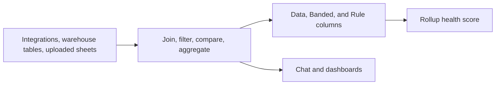

Shape the data you already have into a table you define once. Columns, chat, and dashboards all read that table. It works like a lightweight semantic layer for your account data: you decide the grain and the values, and the rest of Cora uses them.

Only Admins can create, change, or delete a dataset. You do it in chat. Everyone who can open the Accounts page can use a dataset once it is published.

## When to use a dataset

A column reads one field and applies one aggregation. A dataset is the step before that, when the value you want is not already a field.

- Compare two fields, such as active users against contracted seats.
- Take the age of the oldest open ticket.
- Compare a period in the source data, such as this month against last month.
- Take the worst or the minimum value across rows.
- Join two tables.
- Feed an uploaded spreadsheet into a health score.

A dataset cannot read custom column values or column history. An uploaded document, as opposed to a spreadsheet, cannot feed a score.

## Grain

Grain is how many rows the dataset has, and what each row is.

- **Account.** One row per account. Use it with any column aggregation.
- **Event.** One row per event, with an event time. Use it with count, sum, or average in the last N days.
- **Custom.** Any other shape. Chat and dashboards can read it. It does not appear in the column picker.

## Create a dataset in chat

<Steps>
  <Step title="Describe the value">
    Tell Cora what you want, in chat. An Admin has to send this.
  </Step>
  <Step title="Review the query">
    Cora drafts the query and tests it against your data.
  </Step>
  <Step title="Check sample rows">
    Cora shows sample rows. Confirm they are the accounts and values you expect.
  </Step>
  <Step title="Save">
    Confirm, and Cora saves the dataset.
  </Step>
</Steps>

An account or event dataset then appears by its label under **Source** in **Add Custom Column**. Build a Data, Banded, or Rule column on it, and roll those columns into a health score.

Example prompts:

- "Build a dataset with the age, in days, of the oldest open Intercom ticket for each account."
- "Build a dataset that compares active users to contracted seats for each account."

## One dataset or one wide dataset

Use one dataset per source by default: usage, tickets, and finance each get their own. Use one wide account dataset, with several output columns, only when those inputs share a source and a refresh cadence. A wide dataset fails as a unit, so one broken input takes the whole table down.

## Freshness

A view is always current. A table refreshes hourly. Ask Cora to list your datasets to see each one's last run and any error.

## Editing and deleting

Ask Cora to change or delete a dataset. An Admin has to confirm.

- Cora rejects a change that would break a column or another dataset.
- Grain cannot change while a column still reads the dataset.
- Delete is blocked while a column or another dataset uses it. Point those at something else first.

## Uploaded spreadsheets

A spreadsheet can feed a health score only through a dataset. If the sheet already has one row per account, a pass-through dataset is enough: Cora saves a query that selects that sheet, and you build the column on the dataset. A document cannot.
